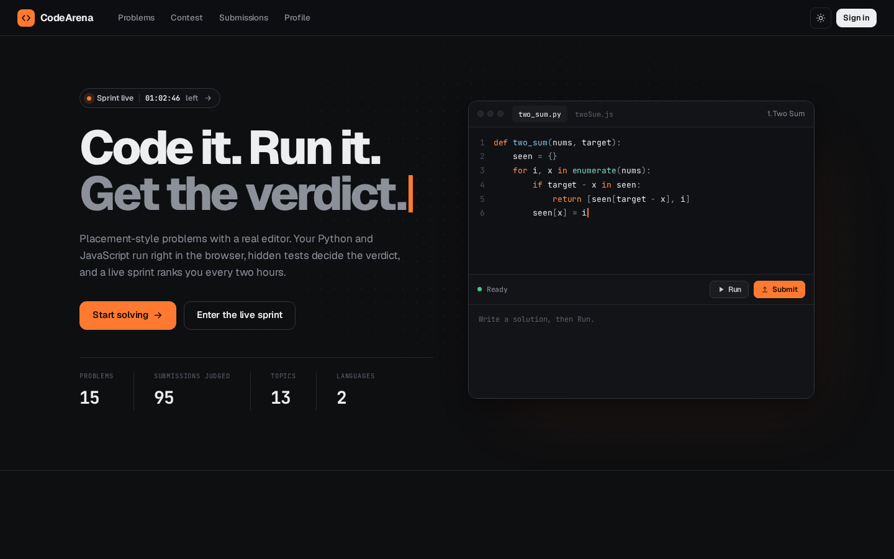
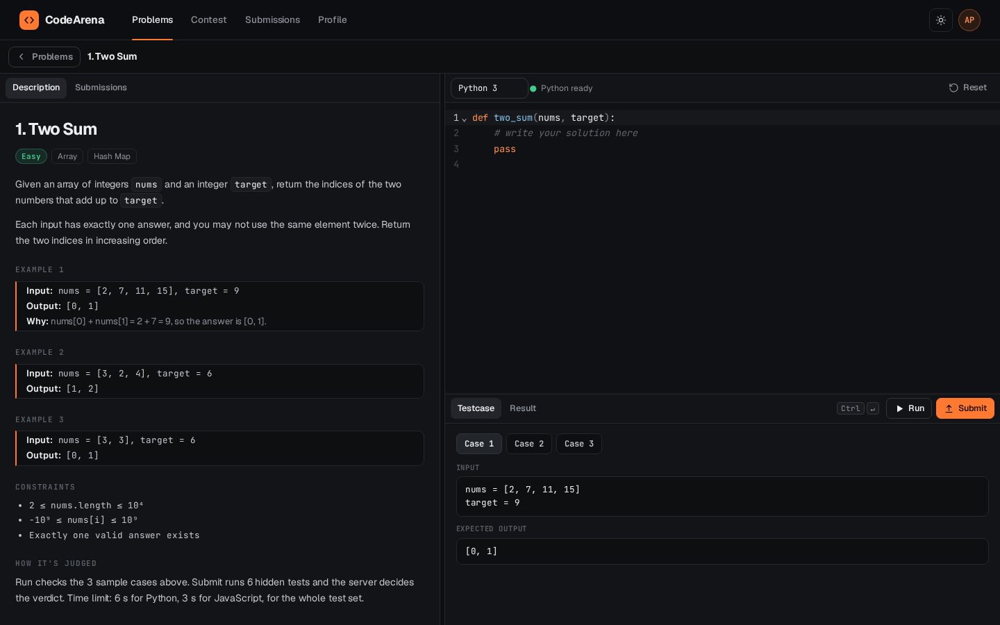
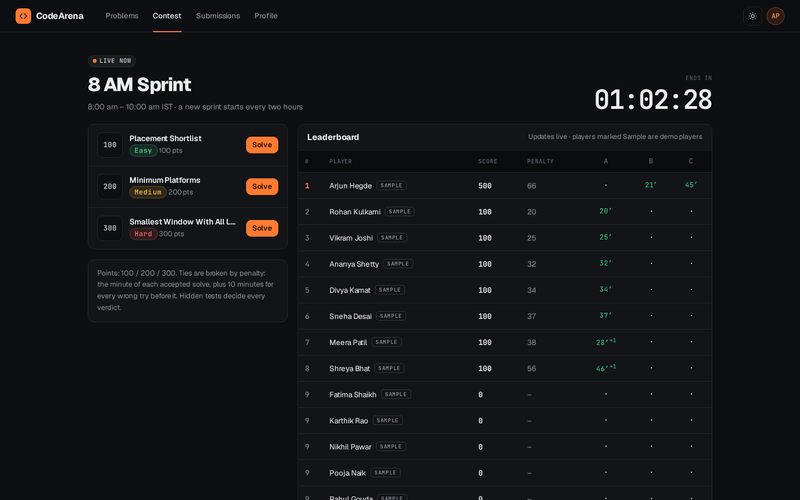
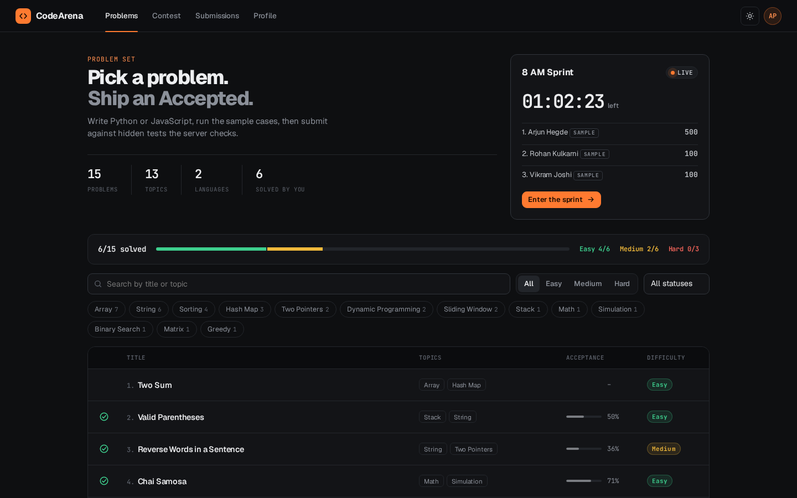

# CodeArena

A coding practice and contest platform for placement preparation. Pick a problem, write a solution in Python or JavaScript in a real code editor, run it on the sample cases, and submit it against hidden tests for a verdict. Code runs in the browser; the server keeps the hidden answers and decides the verdicts for JavaScript.

## Project Overview

CodeArena is a full-stack practice site in the style of LeetCode or HackerRank, built as a student portfolio project. It has a problem bank of 15 placement-style problems with statements, samples and hidden tests; a CodeMirror 6 editor; a Python runtime (Pyodide, CPython compiled to WebAssembly) and a JavaScript runtime, both in Web Workers; a two-hour rolling contest ("sprint") with an ICPC-style leaderboard; submission history; a profile page; and an admin area for editing problems.

The site is a demo: the sprint leaderboard, the profile history and some problem statistics include clearly marked sample players and sample activity. Everything in the app is seeded data or data created by the user.

## Problem Statement

Placement tests ask candidates to read a problem, write code in an unfamiliar editor, and see immediate pass or fail results. Most practice sites need an account and a server-side judge before anything runs, and a student has no easy way to try the same loop locally. CodeArena tries to show the whole loop in one place: an editor, a run against visible samples, a submit against hidden tests, and a timed contest with a live board.

## Key Features

- **Problem bank:** 15 problems (Two Sum, Valid Parentheses, Merge Intervals, Edit Distance and others), each with examples, constraints, sample tests and hidden tests. Problems can be filtered by difficulty, topic and solved state.
- **Code editor:** CodeMirror 6 with syntax highlighting, auto-indent, bracket matching, autocomplete and search; drafts are saved per problem and language.
- **Python and JavaScript execution:** Python runs in the browser through Pyodide inside a Web Worker; JavaScript runs in its own Web Worker.
- **Run and Submit:** Run checks the sample cases and shows input, output and expected output. Submit runs the hidden tests and returns Accepted, Wrong Answer (with the first failing test), Runtime Error (with the message and line) or Time Limit Exceeded.
- **Time limits:** each run has a limit (6 s for Python and 3 s for JavaScript for the whole test set). When the limit is reached the worker is terminated and a fresh one is started.
- **Server-side JavaScript judging:** JavaScript submissions are re-run on the server in a `node:vm` context with a time limit; that result decides the verdict.
- **Sprints (contests):** a two-hour sprint with three problems worth 100, 200 and 300 points, a countdown, and a leaderboard that refreshes every five seconds. Ties are broken by penalty minutes (the minute of each accepted solve plus 10 minutes per earlier wrong try).
- **Submissions and profile:** submission history with a verdict filter and the code of each submission; a profile with solved counts by difficulty, acceptance, streaks and an activity heatmap.
- **Admin area:** add and edit problems (statement, topics, function names, sample and hidden tests), generate starter code for both languages, and fill in expected outputs from a reference JavaScript solution.
- **Light and dark themes**, and a phone layout with Problem, Code and Result tabs.

## Technologies Used

- **Front end:** plain ES modules, no framework; a small history-based router; CSS custom properties for both themes.
- **Editor bundle:** CodeMirror 6, bundled once with esbuild into `public/vendor/codemirror.js`.
- **Code execution:** Pyodide (copied from the npm package into `public/vendor/pyodide/`), and Web Workers.
- **Back end:** Node.js serverless-style handlers in `api/` (designed for Vercel Functions), `node:vm` for JavaScript judging, scrypt password hashing and HMAC-signed HTTP-only session cookies.
- **Storage:** one JSON document per deployment in Vercel Blob (private store); a local JSON file under `.data/` when no Blob token is set.
- **Fonts:** Geist and JetBrains Mono from Google Fonts.
- **Tooling:** npm, esbuild, `node --test` for unit tests, and a Python Playwright script for the end-to-end walk-through.

## Project Screenshots

Screenshots of the live site at https://kumkum-mitbavkar-codearena.vercel.app (desktop, 1440 × 900).


*Home page with the editor demo and headline numbers.*


*Problem 1, Two Sum: statement, Python editor, sample cases and the Run and Submit buttons.*


*Live sprint: problems, countdown and leaderboard. Players marked SAMPLE are demo players.*


*Problem list with difficulty and topic filters.*

## Live Demo and Source Code

**Live demo:** https://kumkum-mitbavkar-codearena.vercel.app

This repository contains the source code of the live version.

Demo accounts (password `demo1234`, shown on the live sign-in page): `student@codearena.in` (student account with sample history) and `admin@codearena.in` (admin account). The demo data can be reset from the admin area.

## Installation Instructions

- Node.js 22.x (the version in `package.json` `engines`).
- npm (ships with Node.js).
- Python 3 is needed only for the optional end-to-end test.

## Setup and Running Instructions

```bash
git clone https://github.com/kumkum-mitbavkar/codearena.git
cd codearena
npm install            # installs everything, including the dev dependencies
npm run build:editor   # rebuilds public/vendor/ (CodeMirror bundle and Pyodide runtime)
npm run dev            # http://localhost:3000
```

`public/vendor/` is not stored in this repository. It is a build output: `npm run build:editor` (`scripts/build-editor.mjs`) bundles CodeMirror from `scripts/editor-entry.js` and copies the Pyodide runtime from `node_modules/pyodide`. Those two packages are dev dependencies, so `npm install` must not be run with `--omit=dev` before the build step. Running the build reproduces the same files that the live site serves.

Open http://localhost:3000 and sign in with a demo account, or create a problem as the admin.

Environment variables read by the code (all optional for local development):

| Variable | Purpose |
|---|---|
| `SESSION_SECRET` | Secret used to sign session cookies. Set a long random value in production. If unset, a fixed development value is used. |
| `DATA_READ_WRITE_TOKEN` | Read-write token for a private Vercel Blob store that holds the app data. When unset, data is kept in a local file. |
| `CODEARENA_DATA_DIR` | Folder for the local data file when no Blob token is set (default `.data/`). |
| `VERCEL` | Set automatically by Vercel; enables the `Secure` flag on the session cookie. |

Other commands:

```bash
npm test                 # unit tests (node --test)
npm run e2e              # browser walk-through with Python Playwright (needs the dev server running)
node scripts/make-seed.mjs   # regenerates api/_lib/seed-problems.json
```

## Project Architecture

```
codearena/
├── public/                  the app served as static files
│   ├── index.html           shell; loads js/app.js and css/app.css
│   ├── js/                  router and shell (app.js), API client, UI helpers, editor wrapper
│   │   ├── views/           landing, home, problems, problem, contest, submissions, profile, admin, login
│   │   └── workers/         js-runner.js and py-runner.js (Web Workers)
│   ├── css/app.css
│   └── vendor/              build output (not in this repository)
├── api/                     request handlers: auth, problems, problem, submit, submissions, profile, contest, admin
│   └── _lib/                judge (JavaScript judging in node:vm), contest scoring, problem bank, stats,
│                            storage (Blob or local file), sessions and HTTP helpers, seed-problems.json
├── scripts/                 dev-server.mjs, build-editor.mjs, editor-entry.js, make-seed.mjs
├── tests/unit/              node:test unit tests for judging, contests and problems
├── tests/e2e/               Python Playwright walk-through and screenshot capture
├── package.json             scripts and dependencies (esbuild, codemirror, pyodide as dev dependencies)
└── vercel.json              output directory, rewrites and cache headers for the deployed site
```

The browser loads the problem list and each problem from `/api/problems` and `/api/problem`. Run uses the browser's worker to execute the code against the sample inputs. Submit sends the code to `/api/submit`. For JavaScript the server re-runs the code against the hidden inputs in `node:vm`; for Python the browser returns the outputs it produced and the server compares them with the expected answers, which never leave the server. Contests are computed from the clock: each two-hour window has a fixed set of problems and a seeded schedule of sample players.

## Future Improvements

- Python verdicts are currently compared from outputs sent back by the browser. Running Python on the server as JavaScript already does would make those verdicts tamper-proof.
- The sample players and sample profile history are generated from fixed seeds; there is no real multi-user contest scoring beyond the signed-in account.
- Storage is one JSON document, which suits a demo but not concurrent writes from many users.
- The end-to-end test needs a running server and Python Playwright; it is not wired into a CI workflow.

## Author Information

**Kumkum Mitbavkar**, BCA student (5th semester) at Gogte College of Commerce, Rani Channamma University, Belagavi, graduating 2027.

- Portfolio: https://kumkummitbavkar.in
- GitHub: https://github.com/kumkum-mitbavkar
